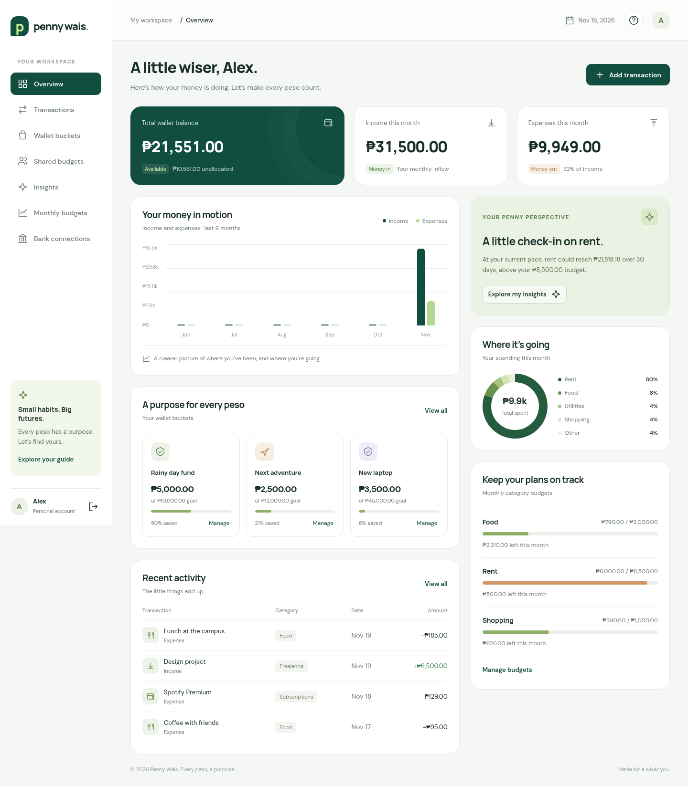

# Penny Wais

Penny Wais is a budgeting and expense management project for students and young adults, including dorm residents, working students and freelancers. It brings personal spending, savings goals and shared bills into one place. A student planning the week can see how much is available after setting aside rent, check where recent spending went and track what a roommate still owes.

## Dashboard overview

The dashboard shows sample data. The wallet holds **₱21,551**, of which **₱10,551** is still unallocated. The three buckets below account for the other **₱11,000**, set aside for a rainy day, a trip and a laptop. Rent makes up **80%** of the month’s spending. The rent budget shows that another **₱500** is available before the monthly limit is reached.

## Four budgeting features

| Feature | Purpose |
| --- | --- |
| **Expense tracking** | Record income and expenses by date, amount and category. Review individual entries to see what contributed to a monthly total. The specification also calls for retrieving transactions when a user authorizes a supported banking service. |
| **In-wallet buckets** | Set aside available money for a purpose such as rent, savings or emergencies. Each allocation reduces the amount left to assign. Users can adjust a bucket as their priorities change. |
| **Shared budgeting** | Create a group, invite members and divide a bill among the people responsible for it. When someone pays their share outside the app, record the settlement so everyone can see the updated balances. |
| **AI-assisted spending predictions** | The specification calls for using past transactions to identify recurring expenses, estimate future spending and flag categories likely to exceed budget. When there is too little history for a forecast, the user should see that explanation. |

## Access and evaluation

Personal records belong to the signed-in user. Shared budgets are visible to authorized group members. The administrator manages account access, monitors application activity and responds to reported concerns.

The project’s evaluation plan calls for at least 20 intended users to assess the interface, core functions and ease of navigation through a survey of at least 15 questions. The full requirements, business rules and use case diagram are in the [Software Requirements Analysis and Specifications](Software%20Requirements%20Analysis%20and%20Specifications%20%281%29.pdf).

## Project team

**Application Development · 4DSA**

Raphael Zeth Acosta, Katrina Mae Arago, Cianne Paulette Guanlao, Christian Miguel Melgar, Zane Orilla, Atasha Pauline Ramos and Jeanne Margarette Vitor.
